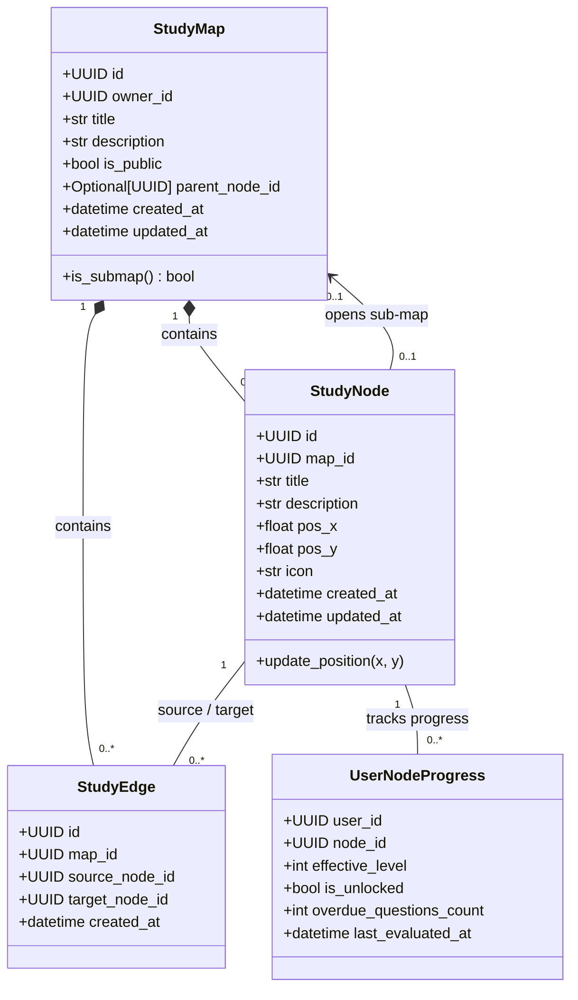

# Especificação Técnica (SPEC) — Sprint 11 (Revisada pós-Builder Check)
## Módulo: Árvore de Estudos RPG & Grafo de Conhecimento com Repetição Espaçada (SRS)
### Projeto: Study Reviewer
**Data:** 25 de Outubro de 2026  
**Status:** Aprovado em Builder Check  
**Documento de Design:** `docs/superpowers/specs/2026-10-25-rpg-study-tree-design.md` e `docs/specs/sprint-11-rpg-study-tree-spec.md`

---

## 1. Visão Geral e Motivação

O **Study Reviewer** evolui de um modelo tradicional de taxonomia estática (Matérias e Temas em árvore rasa de pastas) para uma experiência imersiva de **Árvore de Talentos / Grafo de Aprendizado Estilo RPG (Knowledge Graph & Talent Tree)**.

Inspirado em árvores de habilidades de RPGs (como *Path of Exile*, *Final Fantasy Sphere Grid* e *Grim Dawn*), o estudante/criador tem a liberdade total de posicionar nós em um canvas escuro infinito, traçar dependências direcionadas (pré-requisitos) e associar a cada nó os três pilares de aprendizagem do sistema:
1. **Materiais de Apoio (RAG / Knowledge Sources):** PDFs, anotações e artigos para consulta e perguntas com IA.
2. **Perguntas Abertas (Active Recall & SRS):** Perguntas de resposta aberta avaliadas no motor SRS estrito de 7 níveis (`[1, 7, 15, 30, 60, 90, 180]` dias).
3. **Flashcards (Gap Indexing):** Cartões de memorização rápida atrelados ao catálogo.

### 1.1 O Princípio Central: Gamificação Ancorada em Retenção Real
A progressão de cada nó é estritamente vinculada ao **menor nível SRS das perguntas abertas daquele nó**:
$$\text{Level}(\text{Node}) = \begin{cases} 
\min_{q \in \text{Questions}(\text{Node})} (\text{SRS\_Level}(q)) & \text{se possui perguntas abertas} \\
\min_{s \in \text{SubNodes}(\text{Node})} (\text{Effective\_Level}(s)) & \text{se encapsula um sub-mapa} \\
0 & \text{se nó puramente informativo/materiais}
\end{cases}$$

- **Nível 0 (Iniciado / Informativo):** O estudante criou ou acessou o nó, mas as perguntas ainda não foram respondidas com 100% no SRS.
- **Nível 1 (Ativado / Desbloqueador):** Todas as perguntas do nó atingiram no mínimo o Nível 1 ($1\text{ dia}$ de fixação). Este é o limiar que **desbloqueia os nós filhos dependentes** na árvore de talentos!
- **Níveis 2 a 6 (Progressão de Maestria):** Conforme o calendário de repetição espaçada é cumprido ($7\text{d} \to 15\text{d} \to 30\text{d} \to 60\text{d} \to 90\text{d} \to 180\text{d}$), o nó sobe de patente visual no canvas (de bronze a dourado/lendário).
- **Alerta de Decaimento (Overdue Review):** Se qualquer pergunta do nó vencer ($\text{next\_review\_date} \le \text{hoje}$), o nó emite uma pulsação visual vermelha/alaranjada de "Ameaça de Esquecimento / Decaimento", incentivando a manutenção da maestria.

---

## 2. Decisões Arquiteturais Consolidadas (Builder Check)

1. **Recursão de Sub-mapas:** Quando um nó encapsula um sub-mapa (`parent_node_id`), seu nível efetivo herda o menor nível dos nós contidos no sub-mapa ($\min_{s \in \text{SubNodes}}(\text{Level}(s))$). Ao atingirem todos $\ge 1$, o macro-nó atinge Nível 1 e desbloqueia as dependências do mapa principal.
2. **Propriedade Direta de Conteúdos (`owner_id`):** Para permitir reutilização, desacoplamento e eliminar vulnerabilidades de IDOR, as entidades `Question`, `Flashcard` e `KnowledgeSource` recebem a coluna `owner_id: UUID REFERENCES users(id)` diretamente. Dessa forma, cada usuário possui sua **Biblioteca Pessoal** e pode associar seus conteúdos a quantos nós desejar via $N:N$.
3. **Nós Informativos vs. Desbloqueadores:** Nós que possuem apenas materiais teóricos ou flashcards permanecem Nível 0 (ou informativos/decorativos). Todo nó com papel de destrancar caminhos de progressão deve conter ao menos 1 pergunta aberta no SRS.
4. **Compartilhamento de Mapas (`is_public`):** A tabela `study_maps` inclui a flag `is_public: bool DEFAULT FALSE`. Usuários podem explorar mapas públicos e progredir neles individualmente via `UserNodeProgress`.
5. **Stack Tecnológica do Canvas:** **Vanilla JavaScript + SVG interativo nativo** acoplado aos templates Jinja2 e Tailwind CSS já existentes no projeto, preservando zero etapas extras de build no Dockerfile e garantindo carregamento ultrarrápido.
6. **Compatibilidade Mobile & Camada de Transição:** Os endpoints legados de `Subject` e `Topic` serão mantidos como *façade* na Fase A para não quebrar o cliente mobile Flutter, mapeando internamente para mapas e nós até a atualização completa do app.

---

## 3. Modelo de Domínio (`src/domain/`)



### 3.1 Regras de Domínio e Invariantes
1. **Validação de DAG (Prevenção Estrita de Ciclos):**
   - Ao adicionar ou editar arestas (`StudyEdge`), o domínio executa verificação de ciclo topológico via DFS com coloração de nós. Ciclos disparam `CyclicDependencyError`.
   - Proibida auto-referência (`source_node_id != target_node_id`).
   - Os dois nós devem obrigatoriamente pertencer ao mesmo `map_id`.
2. **Cálculo de Desbloqueio (`UnlockRule`):**
   - Um nó $N$ está desbloqueado se todos os nós de origem das arestas que chegam a ele têm `effective_level >= 1`.
   - Nós sem pré-requisitos iniciam desbloqueados.

---

## 4. Persistência e Modelagem de Dados (`src/infrastructure/`)

```sql
-- 1. Mapas de Estudo
CREATE TABLE study_maps (
    id UUID PRIMARY KEY,
    owner_id UUID NOT NULL REFERENCES users(id) ON DELETE CASCADE,
    title VARCHAR(200) NOT NULL,
    description TEXT,
    is_public BOOLEAN NOT NULL DEFAULT FALSE,
    parent_node_id UUID,
    created_at TIMESTAMP WITH TIME ZONE NOT NULL DEFAULT NOW(),
    updated_at TIMESTAMP WITH TIME ZONE NOT NULL DEFAULT NOW()
);
CREATE INDEX ix_study_maps_owner ON study_maps (owner_id);
CREATE INDEX ix_study_maps_parent_node ON study_maps (parent_node_id);

-- 2. Nós
CREATE TABLE study_nodes (
    id UUID PRIMARY KEY,
    map_id UUID NOT NULL REFERENCES study_maps(id) ON DELETE CASCADE,
    title VARCHAR(150) NOT NULL,
    description TEXT,
    pos_x FLOAT NOT NULL DEFAULT 0.0,
    pos_y FLOAT NOT NULL DEFAULT 0.0,
    icon VARCHAR(50) NOT NULL DEFAULT 'brain',
    created_at TIMESTAMP WITH TIME ZONE NOT NULL DEFAULT NOW(),
    updated_at TIMESTAMP WITH TIME ZONE NOT NULL DEFAULT NOW()
);
CREATE INDEX ix_study_nodes_map ON study_nodes (map_id);

-- 3. Arestas
CREATE TABLE study_edges (
    id UUID PRIMARY KEY,
    map_id UUID NOT NULL REFERENCES study_maps(id) ON DELETE CASCADE,
    source_node_id UUID NOT NULL REFERENCES study_nodes(id) ON DELETE CASCADE,
    target_node_id UUID NOT NULL REFERENCES study_nodes(id) ON DELETE CASCADE,
    created_at TIMESTAMP WITH TIME ZONE NOT NULL DEFAULT NOW(),
    CONSTRAINT uq_study_edge UNIQUE (map_id, source_node_id, target_node_id),
    CONSTRAINT ck_no_self_edge CHECK (source_node_id <> target_node_id)
);
CREATE INDEX ix_study_edges_map ON study_edges (map_id);
CREATE INDEX ix_study_edges_source ON study_edges (source_node_id);
CREATE INDEX ix_study_edges_target ON study_edges (target_node_id);

-- 4. Associações N:N com Conteúdo
CREATE TABLE node_knowledge_sources (
    node_id UUID NOT NULL REFERENCES study_nodes(id) ON DELETE CASCADE,
    source_id UUID NOT NULL REFERENCES knowledge_sources(id) ON DELETE CASCADE,
    PRIMARY KEY (node_id, source_id)
);

CREATE TABLE node_questions (
    node_id UUID NOT NULL REFERENCES study_nodes(id) ON DELETE CASCADE,
    question_id UUID NOT NULL REFERENCES questions(id) ON DELETE CASCADE,
    PRIMARY KEY (node_id, question_id)
);

CREATE TABLE node_flashcards (
    node_id UUID NOT NULL REFERENCES study_nodes(id) ON DELETE CASCADE,
    flashcard_id UUID NOT NULL REFERENCES flashcards(id) ON DELETE CASCADE,
    PRIMARY KEY (node_id, flashcard_id)
);

-- 5. Adição de owner_id para desvincular de Subject/Topic
ALTER TABLE questions ADD COLUMN IF NOT EXISTS owner_id UUID REFERENCES users(id) ON DELETE CASCADE;
ALTER TABLE flashcards ADD COLUMN IF NOT EXISTS owner_id UUID REFERENCES users(id) ON DELETE CASCADE;
ALTER TABLE knowledge_sources ADD COLUMN IF NOT EXISTS owner_id UUID REFERENCES users(id) ON DELETE CASCADE;
CREATE INDEX IF NOT EXISTS ix_questions_owner ON questions (owner_id);
CREATE INDEX IF NOT EXISTS ix_flashcards_owner ON flashcards (owner_id);
CREATE INDEX IF NOT EXISTS ix_knowledge_sources_owner ON knowledge_sources (owner_id);
```

---

## 5. Interface do Usuário (Canvas RPG Vanilla JS + SVG)

- **Canvas Espacial Infinito:** Fundo escuro com grid geométrico sutil, controles de pan (clicar e arrastar no fundo) e zoom suave (roda do mouse e botões +/-).
- **Interação de Edição:**
  - Botão "+ Novo Nó": Cria nó na coordenada central do viewport.
  - Arrastar nós com preservação em lote e debounce de envio de coordenadas.
  - Conexão de Nós: Ponto âncora visual para arrastar e conectar ao nó dependente.
  - Menu de Ações do Nó: Editar metadados, abrir sub-mapa, gerenciar conteúdos e excluir nó.
- **Drawer Lateral de Conteúdo:**
  - Aba 1: Perguntas Abertas (com badges de nível SRS atual 0..6, data da próxima revisão e botões "Criar" / "Vincular da Biblioteca").
  - Aba 2: Materiais de Apoio (RAG) com upload ou vinculação existente.
  - Aba 3: Flashcards com vinculação e criação.
  - Botão de Destaque no Modo Estudo: "Estudar Este Nó Agora (X revisões pendentes)".

---

## 6. Próximo Passo: Plano de Implementação (TDD)
O plano detalhado passo a passo será elaborado em `docs/superpowers/plans/2026-10-25-rpg-study-tree.md` seguindo rigorosamente a metodologia TDD (Test-Driven Development) com cobertura de testes unitários, testes de integração e verificações de segurança Anti-IDOR.
