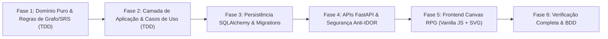

# Plano de Implementação — Árvore de Estudos RPG & Grafo de Aprendizado com SRS
**Data:** 25 de Outubro de 2026  
**Documento de Referência:** `docs/superpowers/specs/2026-10-25-rpg-study-tree-design.md`  
**Metodologia:** TDD Estrito (Test-Driven Development) & Clean Architecture  
**Branch de Trabalho:** `feat/rpg-study-tree`

---

## Visão Geral das Fases

---

## Fase 1: Domínio Puro & Regras de Grafo/SRS (TDD)

### Objetivo
Construir as entidades puras em Python (`@dataclass(slots=True)`), invariantes de validação e serviços de domínio para cálculo de nível SRS e detecção de ciclos em grafo acíclico dirigido (DAG).

### Tarefas
- [ ] **1.1 Entidades e Value Objects em `src/domain/entities/study_tree.py`:**
  - `StudyMap`: `id: UUID`, `owner_id: UUID`, `title: str`, `description: Optional[str]`, `is_public: bool`, `parent_node_id: Optional[UUID]`, `created_at: datetime`, `updated_at: datetime`.
  - `StudyNode`: `id: UUID`, `map_id: UUID`, `title: str`, `description: Optional[str]`, `pos_x: float`, `pos_y: float`, `icon: str`, `created_at: datetime`, `updated_at: datetime`.
  - `StudyEdge`: `id: UUID`, `map_id: UUID`, `source_node_id: UUID`, `target_node_id: UUID`, `created_at: datetime`.
  - `UserNodeProgress`: `user_id: UUID`, `node_id: UUID`, `effective_level: int`, `is_unlocked: bool`, `overdue_questions_count: int`.
- [ ] **1.2 Exceções de Domínio em `src/domain/exceptions/study_tree.py`:**
  - `StudyMapNotFoundError`, `StudyNodeNotFoundError`, `StudyEdgeNotFoundError`.
  - `CyclicDependencyError`, `SelfReferencingEdgeError`, `CrossMapEdgeError`.
  - `InvalidCoordinatesError`, `InvalidNodeTitleError`.
- [ ] **1.3 Serviço de Validação de Grafo (`DAGValidatorService`) em `src/domain/services/dag_validator.py`:**
  - Verificação de ciclo topológico via DFS com coloração de nós (`WHITE`, `GRAY`, `BLACK`).
  - Lança `CyclicDependencyError` se uma nova aresta formar ciclo.
  - Impede auto-referência (`source == target`).
- [ ] **1.4 Serviço de Progressão de Nível e Desbloqueio (`StudyTreeProgressionService`) em `src/domain/services/study_tree_progression.py`:**
  - Calcula o nível do nó:
    - Se tem perguntas: `min(question_srs_levels)` (0 a 6).
    - Se encapsula sub-mapa: herda `min(sub_nodes.effective_level)`.
    - Se apenas materiais: nível 0.
  - Avalia regra de desbloqueio: nó está desbloqueado se todos os nós de origem das arestas que chegam a ele têm `effective_level >= 1` (nós sem pré-requisitos iniciam desbloqueados).
- [ ] **1.5 Testes Unitários de Domínio em `tests/unit/domain/test_study_tree.py`:**
  - Teste de instanciação de `StudyMap`, `StudyNode`, `StudyEdge`.
  - Teste de detecção de ciclo simples ($A \to B \to A$) e ciclo indireto ($A \to B \to C \to A$).
  - Teste de cálculo de nível: mínimo entre perguntas, nós de sub-mapa e nó vazio.
  - Teste de regra de desbloqueio: nó bloqueado com dependência em nível 0, nó desbloqueado quando dependência atinge nível 1.

---

## Fase 2: Camada de Aplicação & Casos de Uso (TDD)

### Objetivo
Implementar DTOs, interfaces de portas (`Protocols`) e casos de uso de manipulação do grafo e estudo de nós.

### Tarefas
- [ ] **2.1 Portas de Repositório em `src/application/ports/study_tree_ports.py`:**
  - `IStudyMapRepository`, `IStudyNodeRepository`, `IStudyEdgeRepository`, `INodeContentRepository`.
- [ ] **2.2 DTOs em `src/application/dtos/study_tree_dtos.py`:**
  - `CreateStudyMapDTO`, `StudyMapDetailsDTO`, `StudyGraphDTO`.
  - `CreateStudyNodeDTO`, `UpdateStudyNodeDTO`, `NodePositionUpdateDTO`.
  - `ConnectNodesDTO`, `NodeStudyHubDTO`.
- [ ] **2.3 Casos de Uso de Mapas e Nós:**
  - `CreateStudyMapUseCase`: cria mapa raiz ou sub-mapa.
  - `GetStudyMapGraphUseCase`: monta o grafo completo com nós, arestas e progresso.
  - `CreateStudyNodeUseCase`: cria nó em coordenada $(x, y)$.
  - `UpdateNodePositionsBatchUseCase`: persiste arrastes do canvas em lote.
  - `ConnectStudyNodesUseCase`: valida DAG e cria aresta.
  - `DisconnectStudyNodesUseCase`: remove aresta.
  - `AttachContentToNodeUseCase` & `DetachContentFromNodeUseCase`: gerencia perguntas, materiais e flashcards.
  - `GetNodeStudyHubUseCase`: carrega itens do nó para estudo ativo.
- [ ] **2.4 Testes Unitários de Aplicação em `tests/unit/application/test_study_tree_use_cases.py`:**
  - Mock de repositórios e validação de orquestração.
  - Verificação de rejeição de ciclos e controle de acesso anti-IDOR.

---

## Fase 3: Persistência SQLAlchemy & Migrations

### Objetivo
Criar modelos de banco de dados, tabelas de associação $N:N$, migrações Alembic e repositórios concretos SQLAlchemy com zero N+1.

### Tarefas
- [ ] **3.1 Modelos ORM em `src/infrastructure/database/models/study_tree.py`:**
  - `StudyMapModel`, `StudyNodeModel`, `StudyEdgeModel`.
  - Tabelas de associação: `node_knowledge_sources`, `node_questions`, `node_flashcards`.
- [ ] **3.2 Atualização de Modelos Existentes:**
  - Adição de `owner_id` em `QuestionModel`, `FlashcardModel` e `KnowledgeSourceModel`.
- [ ] **3.3 Implementação dos Repositórios em `src/infrastructure/repositories/study_tree_repos.py`:**
  - `SqlAlchemyStudyMapRepository`: consultas com `selectinload`.
  - `SqlAlchemyStudyNodeRepository`: suporte a update em lote de coordenadas.
  - `SqlAlchemyStudyEdgeRepository`.
  - `SqlAlchemyNodeContentRepository`.
- [ ] **3.4 Migração Alembic:**
  - Gerar migração para criação das tabelas e novos campos.
  - Script de migração seguro com paridade PostgreSQL e SQLite.
- [ ] **3.5 Testes de Integração em `tests/integration/infrastructure/test_study_tree_repos.py`:**
  - Testes com banco de dados real em memória/SQLite e transações isoladas.

---

## Fase 4: APIs FastAPI & Segurança Anti-IDOR

### Objetivo
Expor endpoints RESTful seguros com autenticação, validação com Pydantic v2 e sanitização write-time.

### Tarefas
- [ ] **4.1 Schemas Pydantic em `src/adapters/api/schemas/study_tree_schemas.py`:**
  - Schemas de request e response com sanitização de texto via `nh3`.
- [ ] **4.2 Controller FastAPI em `src/adapters/api/v1/study_tree_controller.py`:**
  - Rotas `/api/v1/study-maps` (CRUD de mapas).
  - Rotas `/api/v1/study-maps/{map_id}/nodes` e atualização de coordenadas em lote.
  - Rotas `/api/v1/study-maps/{map_id}/edges` (criação e deleção de arestas).
  - Rotas de vinculação de conteúdo: `/api/v1/study-nodes/{node_id}/contents`.
- [ ] **4.3 Testes de Segurança Anti-IDOR (`@pytest.mark.security`) em `tests/security/test_study_tree_security.py`:**
  - Proibir Usuário B de mover nós ou alterar mapas do Usuário A (403/404).
  - Proibir vincular perguntas de terceiros a nós próprios.

---

## Fase 5: Frontend Canvas RPG (Vanilla JS + SVG)

### Objetivo
Desenvolver o editor e visualizador interativo em estilo RPG integrado aos templates Jinja2 e Tailwind CSS.

### Tarefas
- [ ] **5.1 Rotas Web Jinja2 em `src/adapters/web/study_tree_web_controller.py`:**
  - `/study-maps`: Lista de mapas do usuário (estilo seleção de mundos/campanhas de RPG).
  - `/study-maps/{map_id}/canvas`: Interface do Canvas interativo.
- [ ] **5.2 Templates Jinja2 em `src/presentation/templates/study_tree/`:**
  - `maps_list.html`: Cartões de mapas com progresso geral e botão "Criar Novo Mapa".
  - `canvas.html`: Viewport infinito do Canvas, toolbar de ferramentas (Novo Nó, Conectar, Zoom, Centralizar) e Drawer lateral de inspeção.
- [ ] **5.3 Módulo JavaScript em `src/presentation/static/js/study_canvas.js`:**
  - Gerenciador de Pan & Zoom com transform matrix no SVG/container.
  - Nós arrastáveis (*Drag & Drop*) com coordenadas atualizadas via debounce.
  - Desenho de arestas dinâmicas (curvas Bezier cúbicas com setas indicativas de fluxo de energia).
  - Nós estilizados com classes de nível SRS (0 a 6), glow de Nível 1+, cadeado para bloqueados e pulsação vermelha para revisões vencidas.
  - Drawer de Inspeção: abas de Perguntas (com badges de nível), Materiais e Flashcards.
  - Ações de criação rápida e vinculação da biblioteca pessoal.
  - Acessibilidade: modo de navegação alternativo em lista hierárquica acessível (`role="tree"`).

---

## Fase 6: Verificação Completa & BDD

### Objetivo
Validar toda a experiência de ponta a ponta, garantir que o fluxo de SRS continua 100% funcional e que a suite de testes passe sem regressões.

### Tarefas
- [ ] Executar bateria completa de testes de unidade: `uv run pytest tests/unit/ -v`.
- [ ] Executar testes de integração e segurança: `uv run pytest tests/integration/ tests/security/ -v`.
- [ ] Testar fluxo completo de criação de nós, conexão, resposta de perguntas no SRS e desbloqueio em tempo real.
- [ ] Verificar linting e formatação: `uv run ruff check .`
